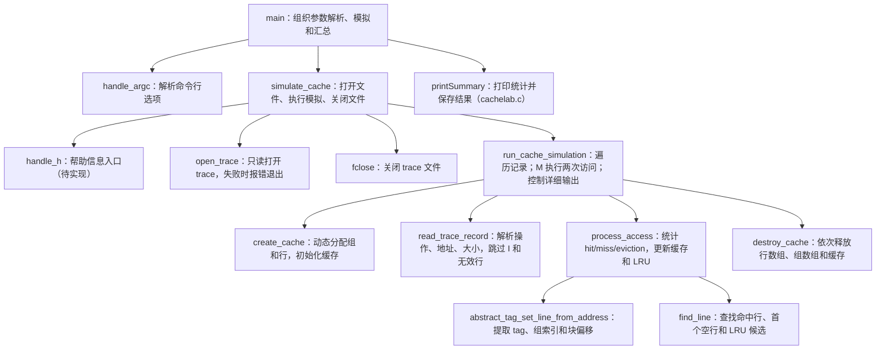

# Cache Lab

## Part A：缓存模拟器

`csim.c` 按 cache → set → line 分层，使用 LRU 替换策略。

### 函数关系

箭头表示函数调用，节点内简述各函数作用。



### 编译与测试

在 `cachelab` 目录中运行：

```bash
chmod +x test-csim
make csim && ./test-csim
```

### 实验结果

首次测试得分为 **1/27**，模拟器各项统计均为 0：

```text
                        Your simulator     Reference simulator
Points (s,E,b)    Hits  Misses  Evicts    Hits  Misses  Evicts
     0 (1,1,1)       0       0       0       9       8       6  traces/yi2.trace
     0 (4,2,4)       0       0       0       4       5       2  traces/yi.trace
     0 (2,1,4)       0       0       0       2       3       1  traces/dave.trace
     0 (2,1,3)       0       0       0     167      71      67  traces/trans.trace
     0 (2,2,3)       0       0       0     201      37      29  traces/trans.trace
     0 (2,4,3)       0       0       0     212      26      10  traces/trans.trace
     1 (5,1,5)       0       0       0     231       7       0  traces/trans.trace
     0 (5,1,5)       0       0       0  265189   21775   21743  traces/long.trace
     1

TEST_CSIM_RESULTS=1
```

修复 `getopt` 选项规则，以及返回局部数组指针的问题后，重新编译测试，全部统计与参考模拟器一致，得分为 **27/27**：

```text
                        Your simulator     Reference simulator
Points (s,E,b)    Hits  Misses  Evicts    Hits  Misses  Evicts
     3 (1,1,1)       9       8       6       9       8       6  traces/yi2.trace
     3 (4,2,4)       4       5       2       4       5       2  traces/yi.trace
     3 (2,1,4)       2       3       1       2       3       1  traces/dave.trace
     3 (2,1,3)     167      71      67     167      71      67  traces/trans.trace
     3 (2,2,3)     201      37      29     201      37      29  traces/trans.trace
     3 (2,4,3)     212      26      10     212      26      10  traces/trans.trace
     3 (5,1,5)     231       7       0     231       7       0  traces/trans.trace
     6 (5,1,5)  265189   21775   21743  265189   21775   21743  traces/long.trace
    27

TEST_CSIM_RESULTS=27
```

## Part B：矩阵转置的缓存优化

### 1 先弄清楚要优化什么

转置就是把 **A 的一行，变成 B 的一列**。A 有 N 行、M 列，B 就有 M 行、N 列。

```text
A                    B
1  2  3              1  4
4  5  6              2  5
                     3  6
```

只要把每个元素放到正确位置，转置结果就对了。但 Part B 还要求：**完成这些搬运时，尽量少发生缓存未命中（miss）。** 同样的元素、同样的结果，换一种访问顺序，miss 数可能差很多。

当前评分脚本的规则如下；转置错误时，对应尺寸不得分。

| 测试尺寸（M × N） | 满分 |     满分要求 |     零分范围 |
| ------------------ | ---: | -----------: | -----------: |
| 32 × 32           |    8 |  miss ≤ 300 |  miss ≥ 600 |
| 64 × 64           |    8 | miss ≤ 1300 | miss ≥ 2000 |
| 61 × 67           |   10 | miss ≤ 2000 | miss ≥ 3000 |

中间区间按 miss 数线性扣分。注意，61 × 67 表示 A 有 **67 行、61 列**。

实现时还要遵守实验限制：不修改 A；最多使用 12 个局部 `int` 变量；不定义额外数组，不使用 `malloc`，不递归。保留提交函数的接口和描述字符串 `"Transpose submission"`。本文对应的实现见 [trans.c](trans.c)。

### 2 把缓存想成 32 个固定位置

测试使用 `s = 5, E = 1, b = 5`：

| 参数  | 含义                 | 本实验的实际大小            |
| ----- | -------------------- | --------------------------- |
| s = 5 | 组索引有 5 位        | 32 个组                     |
| E = 1 | 每组只能放一条缓存行 | 直接映射缓存                |
| b = 5 | 块内偏移有 5 位      | 每块 32 字节，可放 8 个 int |

缓存的数据容量共 1 KiB。这里把内存中连续的 32 字节称为一个“内存块”，缓存中容纳它的位置称为“缓存行”。

记住两件事就能理解后面的优化：

1. **读取一个元素时，会把它所在的整个内存块带进缓存。** 如果接下来访问同一块里的其他元素，就有机会直接命中。写入未缓存的 B 块时，本实验的模拟器也会把该块放进缓存。
2. **每个内存块只能放到指定的缓存组里。** 两个不同的块如果映射到同一组，就只能轮流占用它。即使其他组空着，也不能搬过去。

因此，“总共才用了几百字节，缓存肯定放得下”还不够：**容量够，也可能因为位置冲突而反复 miss。**

想算一个地址属于哪组，直接看地址的二进制位划分。`b = 5`，所以最低 5 位是块内偏移；`s = 5`，所以再往上的 5 位是组索引（set）：

```text
高位                                      低位
┌──────────────┬──────────────┬──────────────┐
│     tag      │     set      │    offset    │
│   剩余高位   │     5 位     │     5 位     │
└──────────────┴──────────────┴──────────────┘
```

**第一步：右移 5 位，去掉 offset。** 对无符号地址来说，右移 5 位等价于整数除以 `2^5 = 32`：

```text
原地址：       [ tag ][ set ][ offset ]
地址 >> 5：    [ tag ][ set ]
```

此时 set 恰好处于结果的最低 5 位。

**第二步：只保留最低 5 位，就得到 set。** 对非负整数，`% 32` 等价于只保留最低 5 位，也可以写成 `& 31`：

```text
右移后的结果： [ tag ][ set ]
再 % 32：            [ set ]
```

所以这几种写法等价：

```c
set = (addr >> 5) & 31;
set = (addr >> 5) % 32;
set = (addr / 32) % 32;  // 整数除法
```

**先去掉低 5 位的 offset，再取接下来的 5 位，自然就是 set。** 两个 32 分别来自 `b = 5` 和 `s = 5`；如果参数不同，就不能都写成 32。通用写法是：

```c
set = (addr >> b) & ((1UL << s) - 1);
```

例如地址 1094，按这三段拆开：

```text
地址 1094：  [ 1 ][ 00010 ][ 00110 ]
                 set = 2   offset = 6
右移 5 位： [ 1 ][ 00010 ]          → 十进制 34
再 % 32：        [ 00010 ]          → 第 2 组
```

剩下的高位 `1` 是 tag。缓存查找时，先用 set 找到组，再比较 tag，判断组里保存的是不是目标内存块。

### 3 为什么最直接的转置很慢

C 的二维数组按行连续存储。读 A 的一行时，访问的是相邻元素；把这些元素写到 B 的一列时，每次却要跳到下一行。

```text
读 A：同一行里向右走 → 地址连续
写 B：同一列里向下走 → 每次跨过一整行
```

读 A 通常能利用一次加载带来的 8 个元素。但写 B 会接触很多不同的内存块；等到读 A 的下一行、再次向这些 B 块写入时，它们可能已经被替换掉了。写 B 还可能挤掉正在读取的 A 块。

本项目记录的 32 × 32 基准结果是 **1184 次 miss**。

这里的局部性可以这样理解：

- **空间局部性**：尽量用上刚加载的内存块里相邻的元素。
- **时间局部性**：尽快再次使用刚加载的数据。本题中每个 A 元素通常只读一次，但同一个 B 块会被多次写入，要争取让它留在缓存中。

所以优化目标是：**把搬运范围缩小，趁相关内存块还在缓存里，尽快把它们用完。**

### 4 第一步：每次只转置一个小块

把大矩阵切成若干小块。先完成一块，再处理旁边的块，一排处理完后再换到下一排。

以 4 × 4 为例，每次只从 A 的 4 行各取 4 个元素，写入 B 对应的 4 行。处理当前块时，反复访问的 B 块数量少了，更有机会留在缓存里。

下面用有含义的名字表示循环变量。`row` 是当前行，`col` 是当前列，`block_row`、`block_col` 是当前小块左上角的位置。

```c
/* 示意：每次处理一个 4 × 4 小块 */
for (int block_row = 0; block_row < N; block_row += 4)
    for (int block_col = 0; block_col < M; block_col += 4)
        for (int row = block_row; row < block_row + 4 && row < N; row++)
            for (int col = block_col; col < block_col + 4 && col < M; col++)
                B[col][row] = A[row][col];
```

两个内层条件分别保证“不超出当前小块”和“不超出整个矩阵”。因此边缘不足 4 行或 4 列也能处理。

32 × 32 的 miss 从 **1184 降到 488**。但每块的每行只有 4 个 int，只使用了一个内存块的一半。尤其是 B：同一个内存块的另一半，要等到处理 A 的下一排小块时才写入，中间可能已经被替换。

这解释了为什么要尝试 8 × 8：对于行首对齐的 32 × 32 矩阵，连续 8 个 int 正好用满一个内存块。**块大小要结合行宽、对齐和冲突选择，并非越大越好。**

### 5 32 × 32：先读满一行，再写 B

改成 8 × 8 分块后，miss 降到 **344**，还没达到满分。

原因是代码仍在交替执行：

```text
读 A 的一个元素 → 写 B 的一个元素 → 再读 A → 再写 B
```

如果写 B 把当前 A 块挤掉，下一次读取同一块里的相邻元素，又会 miss。

解决办法是把一次搬运分成两步：

1. 从 A 当前小块的一行，连续读出 8 个元素，存入 8 个局部变量。
2. 使用这些变量，把这一行转置写入 B 的 8 行。

```text
先读：A 的一行 → 8 个临时变量
再写：8 个临时变量 → B 的一列
```

这样写 B 时即使挤掉了刚才的 A 块，也没关系，因为这一行需要的数据已经全部取出。

这也是临时变量真正发挥作用的地方：**只用一个 tmp，读一个就写一个，访问顺序没有改变；先存下 8 个，再集中写出，才改变了访问顺序。**

为什么写入 B 的这 8 行时，相关数据有机会一直留在缓存里？先看实际要写哪些位置。

处理 A 左上角的 8 × 8 小块时，读完 A 第一行的 8 个元素，会把它们分别写到：

```text
B 第 0 行：[写入][    ][    ][    ][    ][    ][    ][    ] ……
B 第 1 行：[写入][    ][    ][    ][    ][    ][    ][    ] ……
    ……
B 第 7 行：[写入][    ][    ][    ][    ][    ][    ][    ] ……
```

接着读 A 的第二行，就写 B 这 8 行的第二列；再读 A 的第三行，就写第三列。最终填满每行前 8 个位置。

**每行前 8 个 int 正好是一个内存块。因此希望留下来的，是 8 行各自的这一个块，共 8 个块；不是把 B 的 8 个完整行全装进去。**

这些块会不会争抢缓存里的同一个位置？算一下就能看出来。假设 B 的起始地址是 0，方便演示；每行有 32 个 int，所以从一行开头走到下一行开头，地址增加 `32 × 4 = 128` 字节。

| 正在写的 B 内存块    | 起始地址 | 右移 5 位（除以 32） | 再取最低 5 位（% 32）：组号 |
| -------------------- | -------: | -------------------: | --------------------------: |
| 第 0 行的前 8 个元素 |        0 |                    0 |                           0 |
| 第 1 行的前 8 个元素 |      128 |                    4 |                           4 |
| 第 2 行的前 8 个元素 |      256 |                    8 |                           8 |
| 第 3 行的前 8 个元素 |      384 |                   12 |                          12 |
| 第 4 行的前 8 个元素 |      512 |                   16 |                          16 |
| 第 5 行的前 8 个元素 |      640 |                   20 |                          20 |
| 第 6 行的前 8 个元素 |      768 |                   24 |                          24 |
| 第 7 行的前 8 个元素 |      896 |                   28 |                          28 |

它们各有各的位置，所以**写第 7 行的这个块，不会挤掉第 0 行的那个块**。等下一轮回来写第 0 行的第二个元素时，就有机会命中之前留下的块。8 轮写入可以逐步把这 8 个块填满。

真实地址不必从 0 开始，组号也可能绕回 0；对于这里对齐的 8 × 8 小块，这 8 个组号仍然互不重复。需要保留的限定是：**B 的这 8 个块彼此不冲突，读 A 时仍可能把它们中的某个挤掉。**

项目记录的结果是 **288 次 miss**，达到满分线。作为参照，32 × 32 的 A、B 各有 128 个内存块，如果每块只调入一次，总共是 256 次；实际会有冲突和少量测量开销，不应期待完全等于这个数。

### 6 为什么同样的方法在 64 × 64 上失效

把上面的 8 × 8 分块加临时变量方法直接用于 64 × 64，记录的结果是 **4612 次 miss**。

变化在于整行宽度：64 个 int 占 256 字节，相当于 8 个内存块。同一列向下走，缓存组号每次加 8。例如：

```text
B 的第 1 行 → 组 0
B 的第 2 行 → 组 8
B 的第 3 行 → 组 16
B 的第 4 行 → 组 24
B 的第 5 行 → 组 0   ← 与第 1 行冲突
B 的第 6 行 → 组 8   ← 与第 2 行冲突
B 的第 7 行 → 组 16  ← 与第 3 行冲突
B 的第 8 行 → 组 24  ← 与第 4 行冲突
```

这里的行号是小块内的相对位置，起始组号只是示例。关键是：**相隔 4 行的两个块会落入同一组。**

因此，每写完 B 的 8 行，前 4 行的块就被后 4 行挤走。处理 A 的下一行时，又得重新加载它们。这次主要是 **B 的块之间互相冲突**，仅仅先读 A 到局部变量还不够。

退回 4 × 4 能减少这类冲突，但又只能使用半个内存块。记录的结果是 **1700 次 miss**，仍未满分。

需要同时做到：**尽量用满每个 8 元素内存块，又避免反复交替访问 B 中相隔 4 行的块。**

### 7 64 × 64：利用 B 暂存，分三阶段搬运

#### 7.1 先看四个区域最终去哪里

仍以 8 × 8 为大块，把它分成四个 4 × 4 区域。用“左上、右上、左下、右下”描述位置，不必先追踪下标。

```text
A 的当前块                  B 的目标块（完成后）
┌────────┬────────┐         ┌────────┬────────┐
│ A 左上 │ A 右上 │         │左上转置│左下转置│
├────────┼────────┤         ├────────┼────────┤
│ A 左下 │ A 右下 │         │右上转置│右下转置│
└────────┴────────┘         └────────┴────────┘
```

左上和右下留在对应区域；**右上和左下交换区域，并且各自转置**。

难点是搬运顺序。可以借用 B 的右上区域暂存数据，之后再搬到最终位置，不需要额外数组。

#### 7.2 阶段一：读 A 上半，把右半暂存在 B

逐行读取 A 的上半部分，每次仍然先读满 8 个元素。

- 前 4 个来自 A 左上，直接转置写入 B 左上，位置最终确定。
- 后 4 个来自 A 右上，暂时写入 B 右上，稍后搬到 B 左下。

此时 B 是：

```text
┌────────────────┬────────────────┐
│ 左上：已经完成 │ 右上：暂存数据 │
├────────────────┼────────────────┤
│ 左下：尚未处理 │ 右下：尚未处理 │
└────────────────┴────────────────┘
```

B 左上和右上位于同样的上方 4 行。每行左右两半合起来正好 8 个元素，共用一个内存块。这样既使用了整块空间，又没有开始写与它们冲突的下方 4 行。**这只避免了 B 上下两半互相冲突，A 与 B 之间仍可能互相驱逐。**

下面把第一阶段的 set 变化展开。为了能直接写出组号，采用一个具体示例：处理左上角的 8 × 8 块，假设 A、B 基址都按 32 字节对齐，而且各自第一个块都映射到组 0。两者地址不同、tag 不同，所以放进同一组时仍会互相替换。这是演示冲突的地址布局，不表示所有小块的组号都从 0 开始。

64 × 64 矩阵的一整行占 256 字节。换到下一行，同一列的地址增加 256；去掉低 5 位后，块编号增加 `256 / 32 = 8`，所以组号也增加 8（超过 31 就取余）。于是：

| 当前涉及的内存块     | A 的组号 | B 的组号 |
| -------------------- | -------: | -------: |
| 第 0 行的前 8 个元素 |        0 |        0 |
| 第 1 行的前 8 个元素 |        8 |        8 |
| 第 2 行的前 8 个元素 |       16 |       16 |
| 第 3 行的前 8 个元素 |       24 |       24 |

先明确每次搬运的对应关系。例如读 A 第 0 行的 8 个元素后：

```text
临时变量中的前 4 个 → B[0][0]、B[1][0]、B[2][0]、B[3][0]
临时变量中的后 4 个 → B[0][4]、B[1][4]、B[2][4]、B[3][4]
                       暂存到同样 4 行的右半
```

`B[0][0]` 和 `B[0][4]` 在同一个内存块里，属于组 0；第 1、2、3 行的两次写入也分别共用组 8、16、24 中的一个块。**8 次写入只涉及 4 个 B 块。**

逐行处理 A 时，假设这 8 个 A、B 块起初都不在缓存中，只考虑下表列出的矩阵访问：

注意，下面每一轮都是**先把 A 当前行的 8 个元素全部读入临时变量 `a0～a7`，再用这些变量写 B**。写 B 期间不会再读取当前行的 A。这里的临时变量暂存，与“借用 B 右上区域暂存”是两件事。

例如处理 A 第 1 行（下标为 1 的第二行），完整顺序是：

```text
1. 读 A[1][0～7] 到 a0～a7：
   A 的块进入组 8，驱逐上一轮留下的 B 第 1 行块。
   A 的 8 个元素此时已经全部读完。

2. 用 a0 写 B[0][1]：
   访问组 0，hit。
   A 当前行的块在组 8，所以这次写入不会驱逐它。

3. 用 a1 写 B[1][1]：
   访问组 8，miss，因为这个 B 块在第 1 步被 A 驱逐了。
   重新加载 B 第 1 行块，驱逐组 8 中的 A 块。
   没关系，A 的数据已经在 a0～a7 里，后面不再读这个 A 块。

4. 继续用其余临时变量写 B：
   不需要重新读 A；本轮其余 B 写入都是 hit。
```

因此，“是否驱逐”取决于访问的组号是否相同。不是每写一次 B 都会驱逐 A，也不是用了临时变量就消除了冲突。

下面直接列出每次 B 写入是 miss 还是 hit。仍沿用上面的假设：A、B 起始块都映射到组 0，相关块起初都不在缓存中，忽略其他访问。

| 刚读完 A 的哪一行 | 写 B 左半：按实际顺序列出                                                                                      | 写 B 右半暂存区：按实际顺序列出                                    | 本轮 B 写入统计 |
| ----------------- | -------------------------------------------------------------------------------------------------------------- | ------------------------------------------------------------------ | --------------- |
| 第 0 行           | `B[0][0]` **miss**；`B[1][0]` **miss**；`B[2][0]` **miss**；`B[3][0]` **miss** | `B[0][4]` hit；`B[1][4]` hit；`B[2][4]` hit；`B[3][4]` hit | 4 miss，4 hit   |
| 第 1 行           | `B[0][1]` hit；`B[1][1]` **miss**；`B[2][1]` hit；`B[3][1]` hit                                  | `B[0][5]` hit；`B[1][5]` hit；`B[2][5]` hit；`B[3][5]` hit | 1 miss，7 hit   |
| 第 2 行           | `B[0][2]` hit；`B[1][2]` hit；`B[2][2]` **miss**；`B[3][2]` hit                                  | `B[0][6]` hit；`B[1][6]` hit；`B[2][6]` hit；`B[3][6]` hit | 1 miss，7 hit   |
| 第 3 行           | `B[0][3]` hit；`B[1][3]` hit；`B[2][3]` hit；`B[3][3]` **miss**                                  | `B[0][7]` hit；`B[1][7]` hit；`B[2][7]` hit；`B[3][7]` hit | 1 miss，7 hit   |

第一轮 B 的 4 个块都还没加载，所以左半的 4 次写入全是 miss。右半的写入使用刚加载的同一批块，所以全是 hit。

之后每读 A 的一行，只挤掉一个对应的 B 块：读 A 第 1 行挤掉组 8 中的 B 第 1 行块，读 A 第 2 行挤掉组 16 中的 B 第 2 行块，读 A 第 3 行挤掉组 24 中的 B 第 3 行块。因此各轮只有表中标出的那次 B 写入是 miss，其余都是 hit。

可以看到，每轮并非完全没有冲突，而是：

```text
先读 A：暂时挤掉一个 B 块，但把 A 当前行一次读完
再写 B：把那个 B 块装回来，此时 A 当前行已经不需要了
```

本示例第一轮是 1 次 A miss 加 4 次 B miss，之后三轮各是 1 次 A miss 加 1 次 B miss，共 11 次。这个数只针对上述假设下的第一阶段，不代表每个小块或整个函数的固定成绩。换一个小块，A 与 B 的组号关系可能不同，冲突也会变化。

阶段一结束时，上方 4 个 B 块的每个位置都已写过，且分别留在组 0、8、16、24。**“先读满再写”的价值，是让 A 在被挤掉前已被用完；“只写 B 上半”的价值，是不让 B 下半的块也加入这 4 个组的争抢。**

#### 7.3 阶段二：先完成 B 上半，再启用对应的下半行

每次处理 B 上半的一行，按下面的顺序操作：

1. **取回暂存值**：把这一行右半的 4 个暂存元素读到局部变量，避免覆盖后丢失。
2. **读取最终值**：从 A 左下取出一列的 4 个元素，也放到局部变量。
3. **完成当前行**：把刚读取的 A 元素写入 B 当前行的右半，替换暂存内容。这一行的 8 个位置至此全部正确。
4. **搬走暂存值**：把第一步保存的元素，写到 B 下方相隔 4 行的对应行左半，也就是它们在 B 左下的最终位置。

为什么第三步要在第四步之前？

```text
B 上方的一行 ──┐
               ├── 映射到同一个缓存组，只能留一个
B 下方对应行 ──┘
```

**先把上方这行做完，再允许下方那行挤掉它。** 如果先写下方，再回头补上方，就要多切换一次。这是写入顺序影响 miss 的关键。

重复 4 次后，B 左上、右上、左下都已完成，只剩右下。

#### 7.4 阶段三：补齐右下

读取 A 右下并转置写入 B 右下。它与第二阶段写好的 B 左下共享下方 4 行的内存块，因此有机会直接利用刚加载的块。

这里仍可能发生 A 与 B 的冲突，不能保证每次写入都命中。但搬运顺序已经避免了朴素版本在 B 上、下两半之间反复切换。

整个过程可以记成：

```text
先完成左上，右上借位暂存
    ↓
取回暂存，先完成上方行，再搬到下方行
    ↓
补齐右下
```

项目记录的结果是 **1228 次 miss**，达到 64 × 64 的满分线。重点是理解“用完再替换”的顺序；具体下标可以对照 `trans.c` 的三个阶段阅读。

### 8 61 × 67：保留分块，注意边缘

这种尺寸下，A 每行有 61 个 int，B 每行有 67 个 int，都不是 8 的倍数。行首通常不落在内存块边界上，因此一段连续的 8 个元素可能横跨两个内存块。

前面依赖的“8 个元素正好一块”和“每隔 4 行固定冲突”不再直接适用。这里先采用简单分块，并通过测试选择大小：

| 方案                       | 记录的 miss 数 |
| -------------------------- | -------------: |
| 8 × 8 分块，逐元素搬运    |           2119 |
| 8 × 8 分块，先读 8 个再写 |           2009 |
| 16 × 16 分块，逐元素搬运  |           1993 |

16 × 16 在这组测试中表现较好。它改变了块内复用和块间切换的安排，但这不代表继续增大一定更好；最终取舍以实测为准。

边缘的小块可能不足 16 行或 16 列。处理元素时，既要检查小块边界，也要检查矩阵边界，不能访问第 N 行或第 M 列。

### 9 把三种策略放到同一个函数里

当前实现按矩阵尺寸选择处理方式：

| 尺寸     | 主要问题                   | 采用的方法                            | 记录的最终 miss |
| -------- | -------------------------- | ------------------------------------- | --------------: |
| 32 × 32 | 写 B 打断 A 的连续读取     | 8 × 8 分块，先读一行再写             |             288 |
| 64 × 64 | B 的上、下半行映射到相同组 | 8 × 8 内分四区，借位暂存、分阶段写入 |            1228 |
| 61 × 67 | 行首不对齐，边缘不完整     | 16 × 16 分块，加边界判断             |            1993 |

`trans.c` 使用 4 个循环下标和 8 个临时变量，共 12 个局部 `int`。阅读代码时，可以先按作用理解下标：外层两个负责定位小块，内层负责选择当前行或列；不必一开始就逐个追踪字母。

以上数字是项目已有的实验记录，修改代码或构建环境后，以重新测试的输出为准。

### 10 测试与评分怎么看

在 `cachelab` 目录运行：

```bash
make
./test-trans -M 32 -N 32
./test-trans -M 64 -N 64
./test-trans -M 61 -N 67
```

每次重点看提交函数的汇总，例如：

```text
Summary for official submission (func 0): correctness=1 misses=288
TEST_TRANS_RESULTS=1:288
```

- `correctness=1`：这次转置结果正确；为 0 时先排查正确性。
- `misses=288`：提交函数的缓存未命中次数，用它对照第一节的评分表。
- 下面的基准函数成绩只用于比较，不作为你的提交分数。

完整评分脚本还会测试 Part A，打印各项得分和总分。这份脚本使用 Python 2：

```bash
python2 driver.py
```

优化时每次只改变一个因素，例如块大小或写入顺序，然后重新测三种尺寸。这样才能看清改动解决了哪种冲突，以及是否影响其他尺寸。
