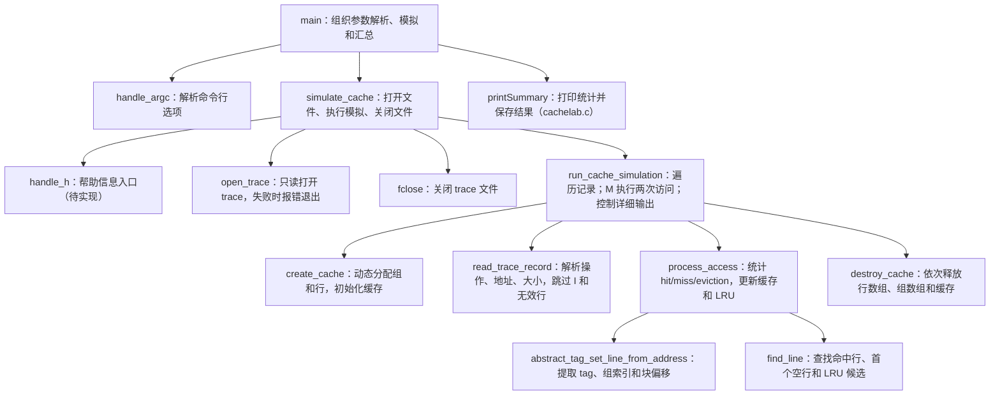

# Cache Lab

## Part A：缓存模拟器

`csim.c` 按 cache → set → line 分层，使用 LRU 替换策略。

### 函数关系

箭头表示函数调用，节点内简述各函数作用。



### 编译与测试

在 `cachelab` 目录中运行：

```bash
chmod +x test-csim
make csim && ./test-csim
```

### 实验结果

首次测试得分为 **1/27**，模拟器各项统计均为 0：

```text
                        Your simulator     Reference simulator
Points (s,E,b)    Hits  Misses  Evicts    Hits  Misses  Evicts
     0 (1,1,1)       0       0       0       9       8       6  traces/yi2.trace
     0 (4,2,4)       0       0       0       4       5       2  traces/yi.trace
     0 (2,1,4)       0       0       0       2       3       1  traces/dave.trace
     0 (2,1,3)       0       0       0     167      71      67  traces/trans.trace
     0 (2,2,3)       0       0       0     201      37      29  traces/trans.trace
     0 (2,4,3)       0       0       0     212      26      10  traces/trans.trace
     1 (5,1,5)       0       0       0     231       7       0  traces/trans.trace
     0 (5,1,5)       0       0       0  265189   21775   21743  traces/long.trace
     1

TEST_CSIM_RESULTS=1
```

修复 `getopt` 选项规则，以及返回局部数组指针的问题后，重新编译测试，全部统计与参考模拟器一致，得分为 **27/27**：

```text
                        Your simulator     Reference simulator
Points (s,E,b)    Hits  Misses  Evicts    Hits  Misses  Evicts
     3 (1,1,1)       9       8       6       9       8       6  traces/yi2.trace
     3 (4,2,4)       4       5       2       4       5       2  traces/yi.trace
     3 (2,1,4)       2       3       1       2       3       1  traces/dave.trace
     3 (2,1,3)     167      71      67     167      71      67  traces/trans.trace
     3 (2,2,3)     201      37      29     201      37      29  traces/trans.trace
     3 (2,4,3)     212      26      10     212      26      10  traces/trans.trace
     3 (5,1,5)     231       7       0     231       7       0  traces/trans.trace
     6 (5,1,5)  265189   21775   21743  265189   21775   21743  traces/long.trace
    27

TEST_CSIM_RESULTS=27
```
