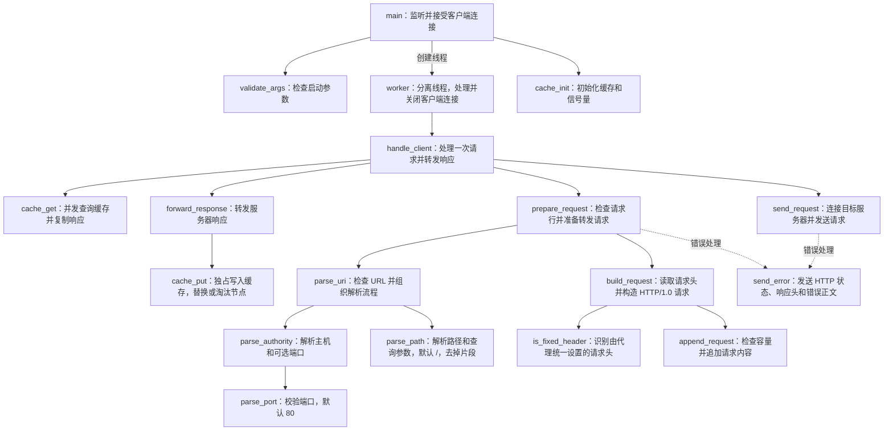

# Proxy 函数结构

下面展示 `proxy.c` 中业务函数的调用关系，省略套接字和 RIO 等库函数。



`parse_uri` 负责输入检查和调用流程；三个 `static` 辅助函数分别处理主机、端口和路径。解析成功返回 `0`，失败返回 `-1`，由 `prepare_request` 触发错误响应。

实线表示普通调用，虚线表示错误分支中的调用。原始实验说明见同目录的 `README`。

## Part 1 测试结果

- 编译通过。
- 通过代理获取 5 个基础测试文件，内容均与原文件一致。
- 非 GET 请求返回 501，不支持的 URL 返回 400。
- 请求构造和错误响应的专项检查通过。

Part 1 完成时，顺序代理已能正常运行，并发和缓存尚未实现。

官方脚本实际输出（2026-11-15）：

```text
*** Basic ***
Starting tiny on 12510
Starting proxy on 2273
1: home.html
   Fetching ./tiny/home.html into ./.proxy using the proxy
   Fetching ./tiny/home.html into ./.noproxy directly from Tiny
   Comparing the two files
   Success: Files are identical.
2: csapp.c
   Fetching ./tiny/csapp.c into ./.proxy using the proxy
   Fetching ./tiny/csapp.c into ./.noproxy directly from Tiny
   Comparing the two files
   Success: Files are identical.
3: tiny.c
   Fetching ./tiny/tiny.c into ./.proxy using the proxy
   Fetching ./tiny/tiny.c into ./.noproxy directly from Tiny
   Comparing the two files
   Success: Files are identical.
4: godzilla.jpg
   Fetching ./tiny/godzilla.jpg into ./.proxy using the proxy
   Fetching ./tiny/godzilla.jpg into ./.noproxy directly from Tiny
   Comparing the two files
   Success: Files are identical.
5: tiny
   Fetching ./tiny/tiny into ./.proxy using the proxy
   Fetching ./tiny/tiny into ./.noproxy directly from Tiny
   Comparing the two files
   Success: Files are identical.
Killing tiny and proxy
basicScore: 40/40

*** Concurrency ***
Starting tiny on port 31486
Starting proxy on port 8831
Starting the blocking NOP server on port 29202
Trying to fetch a file from the blocking nop-server
Fetching ./tiny/home.html into ./.noproxy directly from Tiny
Fetching ./tiny/home.html into ./.proxy using the proxy
Error: Fetch timed out after 5 seconds
Error: Fetch timed out after 5 seconds
Checking whether the proxy fetch succeeded
Failure: Was not able to fetch tiny/home.html from the proxy.
Killing tiny, proxy, and nop-server
concurrencyScore: 0/15

*** Cache ***
Starting tiny on port 7090
Starting proxy on port 31079
Fetching ./tiny/tiny.c into ./.proxy using the proxy
Fetching ./tiny/home.html into ./.proxy using the proxy
Fetching ./tiny/csapp.c into ./.proxy using the proxy
Killing tiny
Fetching a cached copy of ./tiny/home.html into ./.noproxy
Failure: Was not able to fetch tiny/home.html from the proxy cache.
Killing proxy
cacheScore: 0/15

totalScore: 40/70
```

## Part 2 测试结果

官方脚本实际输出（2026-11-15）：

```text
gcc -g -Wall -c proxy.c
gcc -g -Wall proxy.o csapp.o -o proxy -lpthread
*** Basic ***
Starting tiny on 12928
Starting proxy on 21703
1: home.html
   Fetching ./tiny/home.html into ./.proxy using the proxy
   Fetching ./tiny/home.html into ./.noproxy directly from Tiny
   Comparing the two files
   Success: Files are identical.
2: csapp.c
   Fetching ./tiny/csapp.c into ./.proxy using the proxy
   Fetching ./tiny/csapp.c into ./.noproxy directly from Tiny
   Comparing the two files
   Success: Files are identical.
3: tiny.c
   Fetching ./tiny/tiny.c into ./.proxy using the proxy
   Fetching ./tiny/tiny.c into ./.noproxy directly from Tiny
   Comparing the two files
   Success: Files are identical.
4: godzilla.jpg
   Fetching ./tiny/godzilla.jpg into ./.proxy using the proxy
   Fetching ./tiny/godzilla.jpg into ./.noproxy directly from Tiny
   Comparing the two files
   Success: Files are identical.
5: tiny
   Fetching ./tiny/tiny into ./.proxy using the proxy
   Fetching ./tiny/tiny into ./.noproxy directly from Tiny
   Comparing the two files
   Success: Files are identical.
Killing tiny and proxy
basicScore: 40/40

*** Concurrency ***
Starting tiny on port 16565
Starting proxy on port 21030
Starting the blocking NOP server on port 5287
Trying to fetch a file from the blocking nop-server
Fetching ./tiny/home.html into ./.noproxy directly from Tiny
Fetching ./tiny/home.html into ./.proxy using the proxy
Checking whether the proxy fetch succeeded
Success: Was able to fetch tiny/home.html from the proxy.
Killing tiny, proxy, and nop-server
concurrencyScore: 15/15

*** Cache ***
Starting tiny on port 12257
Starting proxy on port 6203
Fetching ./tiny/tiny.c into ./.proxy using the proxy
Fetching ./tiny/home.html into ./.proxy using the proxy
Fetching ./tiny/csapp.c into ./.proxy using the proxy
Killing tiny
Fetching a cached copy of ./tiny/home.html into ./.noproxy
Failure: Was not able to fetch tiny/home.html from the proxy cache.
Killing proxy
cacheScore: 0/15

totalScore: 55/70
```

## Part 3 测试结果

官方脚本实际输出（2026-11-15）：

```text
*** Basic ***
Starting tiny on 24725
Starting proxy on 9551
1: home.html
   Fetching ./tiny/home.html into ./.proxy using the proxy
   Fetching ./tiny/home.html into ./.noproxy directly from Tiny
   Comparing the two files
   Success: Files are identical.
2: csapp.c
   Fetching ./tiny/csapp.c into ./.proxy using the proxy
   Fetching ./tiny/csapp.c into ./.noproxy directly from Tiny
   Comparing the two files
   Success: Files are identical.
3: tiny.c
   Fetching ./tiny/tiny.c into ./.proxy using the proxy
   Fetching ./tiny/tiny.c into ./.noproxy directly from Tiny
   Comparing the two files
   Success: Files are identical.
4: godzilla.jpg
   Fetching ./tiny/godzilla.jpg into ./.proxy using the proxy
   Fetching ./tiny/godzilla.jpg into ./.noproxy directly from Tiny
   Comparing the two files
   Success: Files are identical.
5: tiny
   Fetching ./tiny/tiny into ./.proxy using the proxy
   Fetching ./tiny/tiny into ./.noproxy directly from Tiny
   Comparing the two files
   Success: Files are identical.
Killing tiny and proxy
basicScore: 40/40

*** Concurrency ***
Starting tiny on port 30793
Starting proxy on port 18292
Starting the blocking NOP server on port 9481
Trying to fetch a file from the blocking nop-server
Fetching ./tiny/home.html into ./.noproxy directly from Tiny
Fetching ./tiny/home.html into ./.proxy using the proxy
Checking whether the proxy fetch succeeded
Success: Was able to fetch tiny/home.html from the proxy.
Killing tiny, proxy, and nop-server
concurrencyScore: 15/15

*** Cache ***
Starting tiny on port 22191
Starting proxy on port 26042
Fetching ./tiny/tiny.c into ./.proxy using the proxy
Fetching ./tiny/home.html into ./.proxy using the proxy
Fetching ./tiny/csapp.c into ./.proxy using the proxy
Killing tiny
Fetching a cached copy of ./tiny/home.html into ./.noproxy
Success: Was able to fetch tiny/home.html from the cache.
Killing proxy
cacheScore: 15/15

totalScore: 70/70
```

## 官方测试命令

在仓库根目录执行：

```bash
cd proxylab
make
make -C tiny
NO_PROXY= no_proxy= ./driver.sh
```

`driver.sh` 会测试 Basic（基础转发）、Concurrency（并发）和 Cache（缓存）。目前基础转发、并发和缓存均通过。

已运行官方评分脚本。为适配本机环境，补充了脚本执行权限，将端口检测的 `netstat` 替换为 `ss`，并让 `nop-server.py` 使用 Python 3；评分逻辑未改动。运行时清空 `NO_PROXY`，避免 localhost 请求绕过代理。
